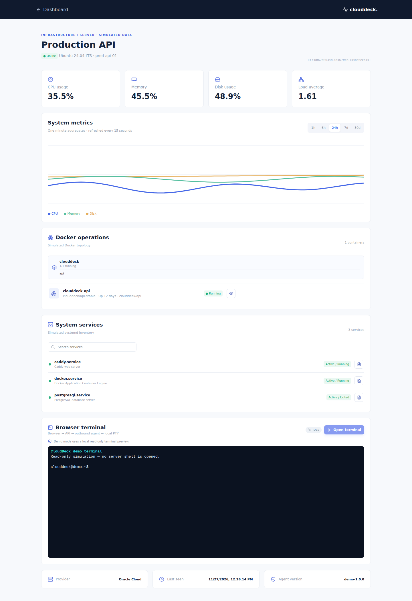
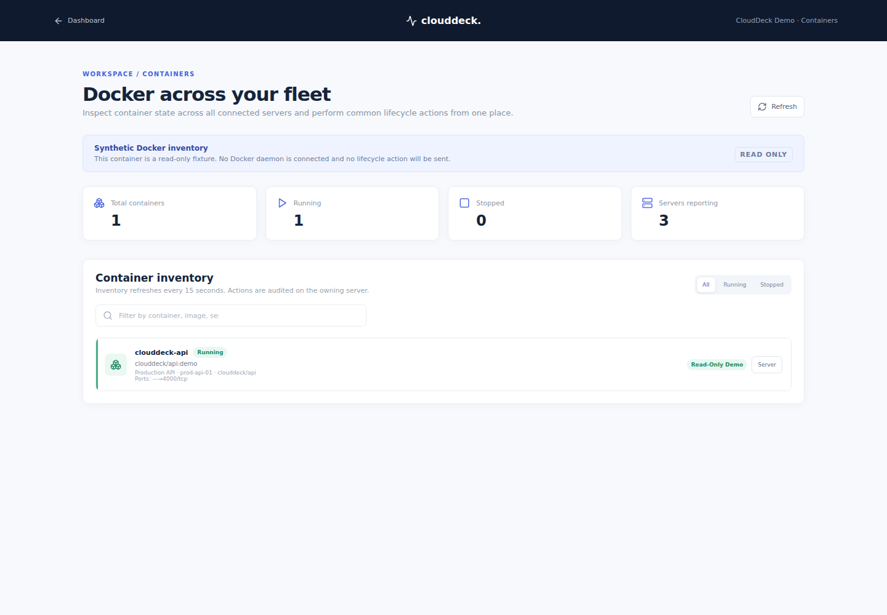
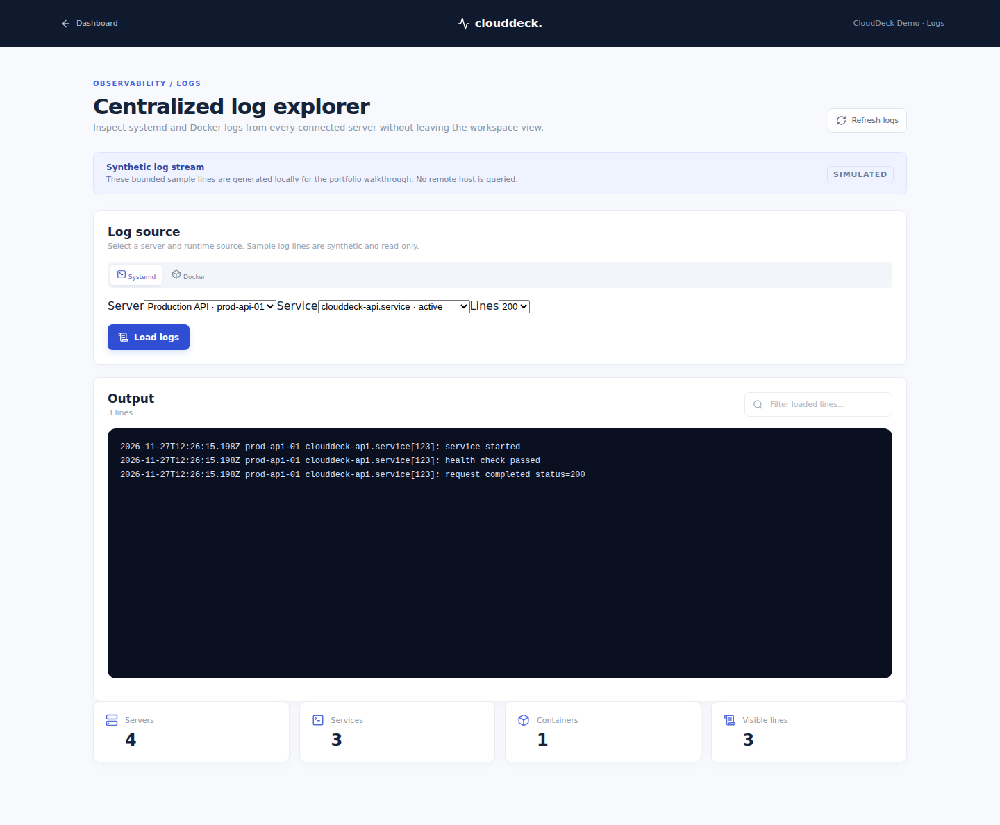
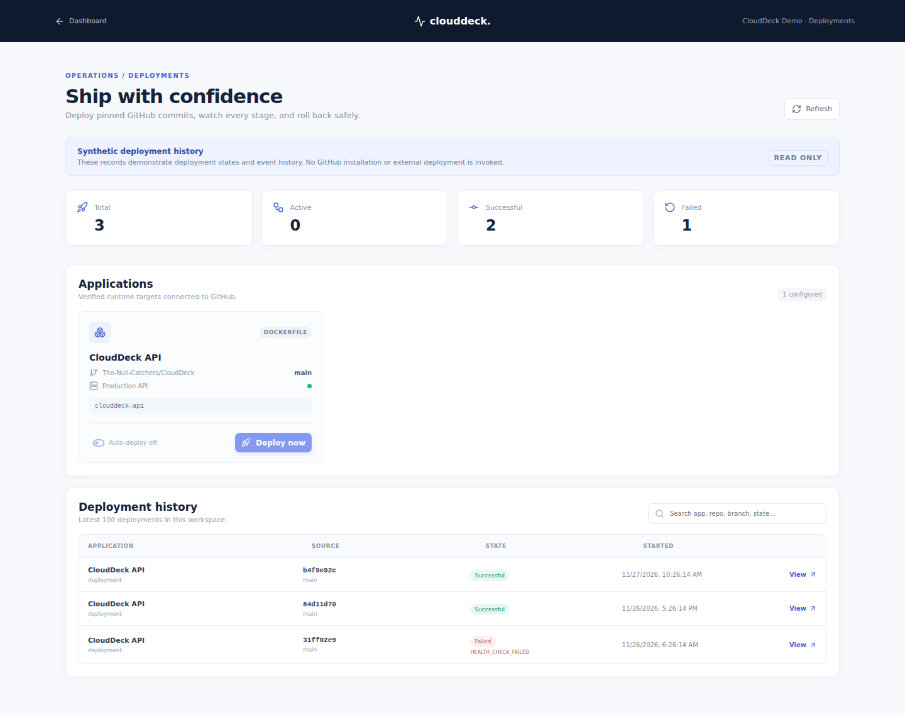
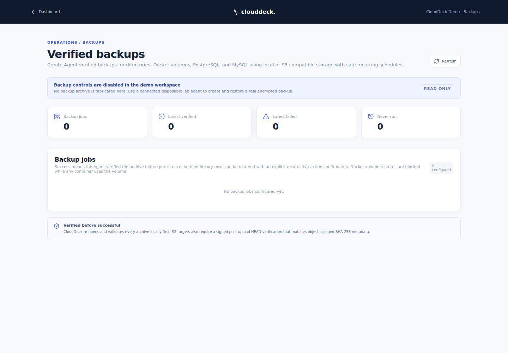

# CloudDeck synthetic UI gallery

These six unmodified Chromium captures came from the running Next.js/Fastify application in [CI run 45998307131](https://github.com/The-Null-Catchers/CloudDeck/actions/runs/45998307131), [artifact 15197650400](https://github.com/The-Null-Catchers/CloudDeck/actions/runs/45998307131/artifacts/15197650400), captured November 27, 2026. PR source head: `42d836fcc65f9994d447ae1959930908599ad914`; the pull-request workflow tested GitHub's merge revision `96cabed69d6f2345e58985cfc161c184a89298fc` against main `b5b9ece8643a01a2eb639080a774563b1b9e55ed`.

The files were downloaded and visually inspected before inclusion. All six are readable with loaded content and no visible passwords, pairing tokens, cookies, or credentials. SHA256SUMS records their bytes. This gallery documents that historical application revision; later workflow artifacts document later revisions.

| Capture | Evidence and limits |
| --- | --- |
| [Fleet dashboard](fleet-dashboard.png) | Four generated servers; no live hosts. |
| [Server details and metrics](server-details.png) | Generated telemetry and simulated Docker/systemd inventory; terminal preview opens no shell. |
| [Docker inventory](docker-inventory.png) | Read-only fixture; no Docker daemon operation. |
| [Log snapshot](logs-snapshot.png) | Three synthetic lines generated locally. The historical UI says “stream”; this is a bounded snapshot, not production streaming evidence. |
| [Deployment history](deployment-history.png) | Generated state/event records; no build, activation, or rollback ran. |
| [Backup management](backup-management.png) | Honest empty/read-only state. No backup execution or recovery is evidenced by this image. |

