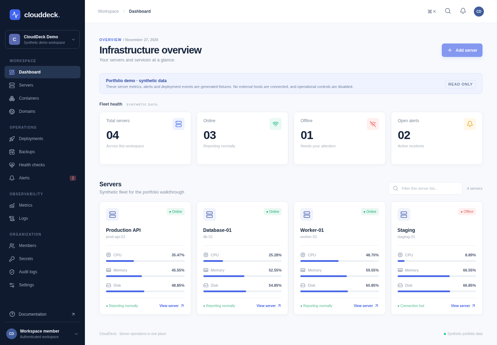

# CloudDeck synthetic UI gallery

These six unmodified screenshots were captured by Playwright 1.55.0/Chromium against the actual running production web build and local Fastify API, with disposable PostgreSQL 17/Redis 7 fixtures on November 27, 2026. Tested source: `95ff51f7e902d7cb066b915c90184327448af2b7`. The full browser suite passed four tests from a newly migrated/seeded database in 11.4 seconds; the six-screen capture also passed three consecutive runs with deliberately delayed workspace responses. Node 22.23.5, npm 11.9.0, 1440×1000 viewport, local Linux workstation. These are genuine synthetic UI captures, not live-host operations.

All six were visually inspected before inclusion: readable content, no visible credentials, and no loading/broken states. SHA256SUMS records their bytes. The log image shows three synthetic snapshot lines; backup management is intentionally empty/read-only and proves no backup execution.

The originally requested [CI artifact captures](historical-42d836f/README.md) are retained unmodified in `historical-42d836f/`, with their source/merge/run provenance and separate checksums. Later CI screenshot artifacts validate the source revisions stated by their runs; do not conflate them with this local capture.

| Capture | Evidence and limits |
| --- | --- |
| [Fleet dashboard](fleet-dashboard.png) | Four generated servers; no live hosts. |
| [Server details and metrics](server-details.png) | Generated telemetry and simulated Docker/systemd inventory; terminal preview opens no shell. |
| [Docker inventory](docker-inventory.png) | Read-only fixture; no Docker daemon operation. |
| [Log snapshot](logs-snapshot.png) | Three synthetic lines generated locally. This is a bounded snapshot, not production streaming evidence. |
| [Deployment history](deployment-history.png) | Generated state/event records; no build, activation, or rollback ran. |
| [Backup management](backup-management.png) | Honest empty/read-only state. No backup execution or recovery is evidenced by this image. |

